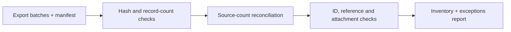

> **Proprietary - All Rights Reserved.** Licensed to Sandeep Grover. No reuse, copying, modification, or distribution without prior written permission. See LICENSE.

# PMS export reconciliation demonstration

This small synthetic demonstration audits a pre-existing export archive. It is **not a Track PMS connector** or proof of access to that system. No client or guest data is included.

## Architecture



## Run

Python 3.10+, standard library only:

```sh
python main.py
python -m unittest -v
```

The demo compares two synthetic reservations and two messages with supplied source counts, verifies batch hashes and counts, flags duplicate/missing IDs, checks reservation references, and verifies referenced attachments exist. A second output deliberately removes the synthetic attachment to demonstrate a disclosed gap. Audit operations preserve all input records.

Processing: supplied manifest and JSON batches → integrity and reconciliation checks → inventory, counts, exceptions.

Limitations: source counts are provided rather than obtained from a live API. Valid hashes establish agreement with the manifest, not completeness of the originating source. This is one export-quality component, not a searchable guest archive, a live integration, or a security assessment. A production extraction first needs authorized source access, data mapping, pagination tests and access controls.
